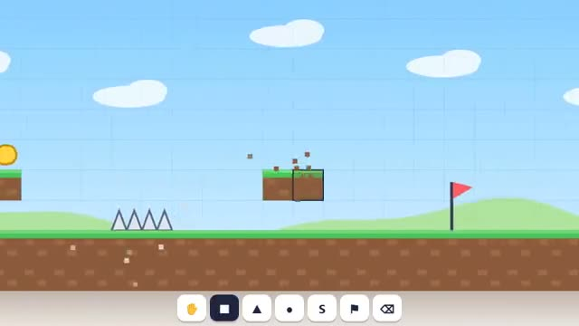

# Level Maker

Build a level, share it, play your friends’ levels. A multiplayer starter game from [Multiplayer Agent](https://multiplayeragent.com): 2D, co-op, 1–8 players, with bots that run your levels.

## How it plays

Paint blocks, spikes, coins, a start and a goal on the grid, together with everyone in the room. Press Play to run it against the bots, then share it so other players can play it and like it.

**Controls:** Mouse or touch to build; arrow keys or A/D and Space, or on-screen buttons, to play.

## Make it yours in the Game Builder

Open the [Game Builder](https://multiplayeragent.com), choose **Start from a starter game** and pick Level Maker. It opens as version 1 in your studio, ready to play and publish. Then ask for changes, for example:

- Add springs and moving platforms
- Feature one level each week
- Add a lava tile that rises slowly

## Run it yourself

1. Get a free publishable key (`pk_…`) at [multiplayeragent.com](https://multiplayeragent.com).
2. In `index.html`, put it in place of `pk_REPLACE_ME` in the `MP_CONNECT` block.
3. Open `index.html` in a browser. No build step and no server needed.

Without a key it still runs offline: the three example levels, building, bots and drafts all work. Sharing and leaderboards need the key.

## How it is built

- One `index.html`. The comment at the top of the script maps the code and explains the multiplayer.
- **Level sharing:** Publish your level; others browse the top and newest, play, like and report them. A link (`?level=<id>`) opens one for friends, in a room of its own.
- **Saves:** Your unfinished levels are kept as drafts in your player save.
- **Live sync:** Everyone in the room builds the same level and sees each other play it.
- **Bots:** Bots run the level when you press Play.
- **Leaderboard:** The fastest clear of each shared level.
- **Player logins:** Pick a name and password to publish levels and keep them yours.
- The built-in levels are plain text in the `EXAMPLES` section, one string per row.
- `?attract` runs it offline: it paints a little course, then bots run it. The preview video is recorded from it.

## License

MIT.
